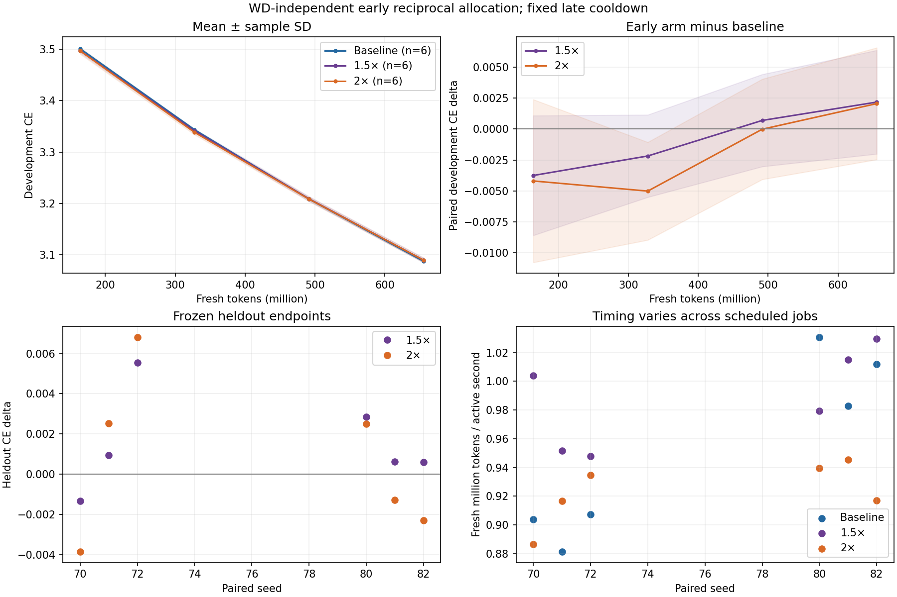

# Early reciprocal allocation: two-hour experiment report

Completed2026-10-17T13:42:51.690129+00:00, within the requested11:53–13:53UTC window on17October2026. All code/configs/results are on `martinjaggi/nanochat:unnormalized-muon`.

**Recommendation: retain the tuned plateau-plus-cooldown baseline. Neither tested WD-independent reciprocal early curve shows a reliable endpoint gain.** This is a negative result for this small controlled family, not a claim that every reciprocal schedule or horizon must fail.

## Main result: six paired seeds

All runs train for20000updates/655.36M fresh tokens. The entire late65% cooldown is identical. Negative deltas favor the variant; CE is natural-log cross-entropy per target token.

| Early peak | Tau after warmup | Original262k heldout delta, mean / SD | Untouched2M heldout delta, mean / SD | Seeds |
|---|---:|---:|---:|---:|
| 1x baseline | infinity | reference | reference | 6 |
| 1.5x | 13920 | +0.001538 / 0.002366 | +0.000718 / 0.002512 | 6 |
| 2x | 6960 | +0.000727 / 0.003945 | +0.000659 / 0.002864 | 6 |

The seed0 development screen was almost tied: baseline3.090447664,1.5x3.089904308,2x3.089890957. The2x choice was frozen on that screen;1.5x was retained as a secondary comparison before any fresh heldout endpoint because their gap was only0.000013CE. Paired seeds70/71/72 were followed by a balanced frozen-family replication on80/81/82. The extension followed an ambiguous initial result: six-seed estimates are descriptive, without a fixed-sample significance claim. Seeds vary model initialization; the native deterministic data stream is retained.

The unchanged baseline repeat differed from the earlier baseline endpoint by+0.000907CE despite exactly identical initial parameters, all LR/WD inputs and data cursors. The first loss discrepancy was about1e-6 at update11. Compiled BF16 training is not bitwise reproducible across these jobs; no optimizer/model/data recipe change was found. Tiny single-run differences are therefore not a stable optimum.

[Every paired seed, cohorts and curves](EARLY_ALLOCATION_REPLICATION.md). [All30original/larger heldout scores](EARLY_ALLOCATION_LARGE_HELDOUT.md).

## Weight-decay confound tested directly

The baseline contraction product is0.044527729. Fixed-WD1.5x/2x curves give0.031427187/0.023892497, respectively. Final-product matching was solved with actual matrix LRs, not CLI LRs. All coefficients and products were checked against executed logs.

| Comparison | Original heldout mean delta | Larger heldout mean delta | n |
|---|---:|---:|---:|
| 2x vs baseline LR with WD .05512714 | +0.000466 | +0.000072 | 3 |
| 1.5x vs baseline LR with WD .05108095 | +0.001576 | +0.000169 | 3 |
| 2x with WD .03827981 vs original baseline | +0.001475 | +0.001493 | 3 |
| 2x with entire contraction history matched vs original baseline | +0.003186 | +0.003182 | 3 |

No contraction-matched comparison shows a consistent advantage. Matching final products does not match decay histories. The stronger history diagnostic sets lambda_t=lambda_base*eta_base(t)/eta_early(t), preserving every scheduled contraction coefficient. It uses linear WD warmup during the reciprocal phase and ordinary fixed WD afterwards; its implied FW radius changes. It is an empirical diagnostic, not fixed-domain FW.

The early validation advantage fades during the common late cooldown. The history diagnostic fails the predeclared equal-time promotion gate: its seed0 development score3.090945959 is worse than baseline, and paired heldout signs are mixed. **No new independent equal-time reruns were launched.** Token-clock curves versus seconds are descriptive and are not matched equal-time endpoints.

[All control scores](EARLY_ALLOCATION_RESULTS.md), [LR/WD/contraction geometry](EARLY_ALLOCATION_PROTOCOL.md).

## Minimal implementation and frozen recipe

* Source fork base commit`b2bdf9890e028965ee7f2e97acc02d72b3c663ec`; first early-schedule implementation`55c6753066901695dd5fbe81304510c0d130f887`. Existing optimizer direction kernels were not changed in this continuation.
* `cooldown_schedule.early_reciprocal` plus one matrix-only branch in `scripts/base_train.py`; `run.py` forwards the peak multiplier. For s=t-40 and T=6960, eta=.005*k/(1+s/tau), tau=T/(k-1). Warmup reaches k*.005. At update7000, join exactly. Updates7000 onward call the original cooldown function directly; last realized eta=.00005038076923. Tau is independent of WD.
* History diagnostic adds a separate WD-only hook, preserving actual eta*lambda each update; no parameter direction or auxiliary update changes.
* Dense depth8,width512,4heads,context1024;125829354 trainable parameters,25166016Muon parameters in52native matrices. Device batch32,accumulation1,32768fresh tokens/update;5.2083tokens per total parameter/run. Native ClimbMix/BOS packing and32k tokenizer; no Atlas assets.
* Native BF16 computation and embedding storage, FP32 Muon parameters/momentum; FP8off. Clean direction retains native Nesterov, five Polar Express iterations and Frobenius correction; row equilibration/NorMuon off. Shape factors stay inside Q, with one actual canonical eta per matrix group. Ordinary unmasked decay only.
* CLI matrix LR .02 gives actual join LR .005. Baseline fixed WD .04593746995939655.40-update warmup; final65% linear matrix cooldown to .01of join rate. Auxiliary AdamW schedules and native momentum .85→.97→.90 remain unchanged. Fixed tuning validation262144targets; original heldoutblock6, larger segment batch64–127/2097152targets.

## Correctness and reproducibility

*67CPU optimizer/math/queue checks passed, plus2focused equivalent-push checks;4GPU-only tests skipped on the CPU development pod. B300128-update integration check exercises all schedule phases, with maximum eta*lambda error5.42e-20.
* Complete audit passes for36full runs/720000updates: exact native parameter partition, paired initial hashes, expected LR/WD, unchanged auxiliary schedules/data cursors, fixed validation hashes, correct gradient counts and contraction exposure. [Machine-readable audit](EARLY_ALLOCATION_EXECUTION_AUDIT.json).
* All30frozen checkpoints reproduce both original score/hash pairs within1e-5 before larger scoring. Data are cloned from the native reused buffers; validation epoch1 prevents wrapping. The larger set is never used for LR or WD selection. Per-sequence nats/counts remain outside Git; no independence assumption is made for packed sequences.
* Native NS is approximate, momentum is retained and training is stochastic: this does not validate an exact FW theorem. Results concern this model/batch/horizon/family only.

## Timing and project budget

| Arm | Median training-active sec | Median worker end-to-end sec | Fresh Mtoken/sec (median) |
|---|---:|---:|---:|
| baseline | 694.471 | 740.242 | 0.9452 |
| mid | 661.025 | 711.177 | 0.9916 |
| early | 707.874 | 753.260 | 0.9259 |
| history | 689.480 | 734.799 | 0.9505 |

Job throughput varies across scheduled devices/time. These identical native compute pipelines do not establish a method speed advantage from the observed timing differences. All full runs have20000fresh forward/backward evaluations and no extra optimizer probes. Compilation/warmup/evaluation/checkpoint overhead is included in worker/job cost and recorded separately; those clocks can overlap and should not be summed blindly.

New continuation:36completed20k-update training runs, one passed128-update check, one failed short check, and one completed30-checkpoint evaluation. New conservatively charged request-hours **8.118327**, previous **37.069782**, whole project **45.188109/50B300-hours**. Reservations0; all requests/pods/GPU allocations released, including failed jobs. At mostsix outstanding requests and exactlyone actualB300 per job. Charge includes queue/startup/monitoring time and is not a billing measurement.

The heldout-only job took114.259worker seconds, including9.764compilation seconds;2400evaluation microbatch forwards/78643200targets, zero training updates or gradients. Exactcommands, runtime limits, commits and paths are preserved in each run's submission.json and [EXPERIMENTS.csv](EXPERIMENTS.csv). Raw outputs/checkpoints/data are outside Git under`/mloscratch/homes/mljaggi/nanochat-unnormalized-muon-runs/<run_id>/`.

Operational issues preserved: the64-update check had no valid phase between40-update warmup and cooldown; corrected to128with fail-fast validation. A redundant concurrent Git push found the same HEAD already upstream; no result was lost, and a two-test fix accepts only identical remote/local tips while preserving real failures. No branch reset, forcepush, alternate GPU or unrelated job deletion was used.

Use the original plateau/cooldown baseline for this setup. The tested independent-tau early allocation, final-product controls and complete-history diagnostic supply no reliable reason to replace it. Further schedules/horizons remain new hypotheses and need a fair baseline; remaining budget is not a spending target.
