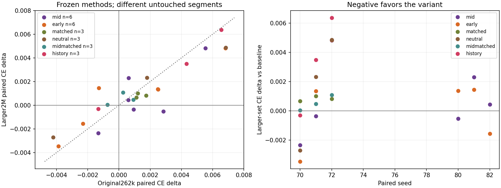

# Larger untouched heldout evaluation

All30already-frozen final checkpoints scored on the SAME2097152target tokens, native validation batch positions64–127. Validation epoch1 is asserted; these positions are disjoint from original tuning/heldout blocks0–7. Same ClimbMix/native32k tokenizer,32x1024, native BF16 compute/FP32 matrix parameters and compiled loss path. NO training or gradient evaluations. Every checkpoint reproduced its ORIGINAL tuning and heldout hashes/scores within1e-5 before larger scoring.

This adds a new evaluation segment without replacing the original outcomes or changing any settings. Absolute CE differs across segments; compare paired method differences within a segment. The fixed-WD family has6seeds; contraction controls have3. Per-sequence nats/counts are retained outside Git; packed sequences can be dependent, so no independent-sequence significance claim is made.

| Seed | Arm | Original paired CE delta | Larger paired CE delta | Larger CE | Larger BPB |
|---|---|---:|---:|---:|---:|
| 70 | baseline | +0.000000000 | +0.000000000 | 3.113696814 | 0.950745310 |
| 70 | early | -0.003867149 | -0.003471136 | 3.110225677 | 0.949693607 |
| 70 | history | -0.001327515 | -0.000311375 | 3.113385439 | 0.950660740 |
| 70 | matched | +0.001123667 | +0.000660419 | 3.114357233 | 0.950942860 |
| 70 | mid | -0.001323700 | -0.002353907 | 3.111342907 | 0.950029048 |
| 70 | midmatched | -0.000741005 | +0.000038385 | 3.113735199 | 0.950753250 |
| 70 | neutral | -0.004207373 | -0.002703428 | 3.110993385 | 0.949925757 |
| 71 | baseline | +0.000000000 | +0.000000000 | 3.109717131 | 0.949528764 |
| 71 | early | +0.002515316 | +0.001342058 | 3.111059189 | 0.949941782 |
| 71 | history | +0.004330873 | +0.003489017 | 3.113206148 | 0.950597949 |
| 71 | matched | +0.001197100 | +0.001009941 | 3.110727072 | 0.949839074 |
| 71 | mid | +0.000946522 | -0.000358582 | 3.109358549 | 0.949421321 |
| 71 | midmatched | +0.000917673 | +0.000469208 | 3.110186338 | 0.949673575 |
| 71 | neutral | +0.001791477 | +0.002324820 | 3.112041950 | 0.950246920 |
| 72 | baseline | +0.000000000 | +0.000000000 | 3.114272118 | 0.950921153 |
| 72 | early | +0.006819248 | +0.004828215 | 3.119100332 | 0.952405979 |
| 72 | history | +0.006553173 | +0.006368637 | 3.120640755 | 0.952877563 |
| 72 | matched | +0.001748562 | +0.000813007 | 3.115085125 | 0.951175592 |
| 72 | mid | +0.005539656 | +0.004814148 | 3.119086266 | 0.952394105 |
| 72 | midmatched | +0.000256538 | +0.001086950 | 3.115359068 | 0.951252806 |
| 72 | neutral | +0.006840467 | +0.004856348 | 3.119128466 | 0.952409475 |
| 80 | baseline | +0.000000000 | +0.000000000 | 3.110992432 | 0.949925975 |
| 80 | early | +0.002494812 | +0.001369715 | 3.112362146 | 0.950325663 |
| 80 | mid | +0.002848148 | -0.000531673 | 3.110460758 | 0.949758291 |
| 81 | baseline | +0.000000000 | +0.000000000 | 3.113025904 | 0.950541423 |
| 81 | early | -0.001296520 | +0.001451731 | 3.114477634 | 0.950985036 |
| 81 | mid | +0.000620842 | +0.002307653 | 3.115333557 | 0.951236999 |
| 82 | baseline | +0.000000000 | +0.000000000 | 3.111200571 | 0.949988838 |
| 82 | early | -0.002302647 | -0.001568079 | 3.109632492 | 0.949513540 |
| 82 | mid | +0.000594378 | +0.000429869 | 3.111630440 | 0.950124035 |

mid: n=6, original mean delta+0.001538; larger-set mean **+0.000718CE**, sampleSD **0.002512**.

early: n=6, original mean delta+0.000727; larger-set mean **+0.000659CE**, sampleSD **0.002864**.

matched: n=3, original mean delta+0.001356; larger-set mean **+0.000828CE**, sampleSD **0.000175**.

neutral: n=3, original mean delta+0.001475; larger-set mean **+0.001493CE**, sampleSD **0.003848**.

midmatched: n=3, original mean delta+0.000144; larger-set mean **+0.000532CE**, sampleSD **0.000527**.

history: n=3, original mean delta+0.003186; larger-set mean **+0.003182CE**, sampleSD **0.003351**.

Final-contraction-controlled early minus matched: larger-set mean **+0.000072CE**, sampleSD **0.004080**, n=3.

Final-contraction-controlled mid minus midmatched: larger-set mean **+0.000169CE**, sampleSD **0.003179**, n=3.

Evaluation job `um-earlyalloc-large-eval-001`: worker elapsed114.259s, all scoring44.192s (includes first compilation), compilation9.764s; checkpoint copies50.492s;2400actual evaluation microbatch forwards/78643200evaluated targets. Zero fresh gradients or optimizer updates. Maximum tuning roundtrip error0CE. Target hash`ebdc44eb8090c6350e2b966a913bbfa01fd1e1420f352345c3b9e2c89e20051a`.

