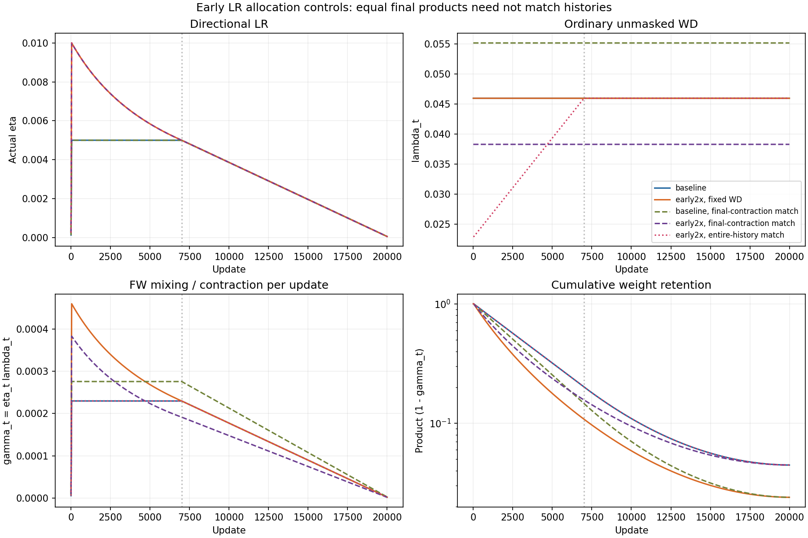

# Early reciprocal allocation, 17 October 2026

New two-hour authorization 11:53–13:53 UTC. Total campaign cap remains 50 B300-hours, maximum six outstanding jobs, exactly one verified B300 per run. Prior conservative charge 37.0698 hours. No other campaign jobs active at start.

Starting baseline: clean normalized Muon, native Nesterov/Polar Express/Frobenius correction, ordinary fixed WD 0.04593746995939655, CLI LR .02 = actual eta .005, depth8/125829354 parameters, context1024, 32768 fresh tokens/update, 20000 updates = 655.36M tokens. ClimbMix/native32k tokenizer, BF16 compute/FP32 Muon masters. Auxiliary schedules and momentum unchanged.

Only the matrix early plateau and its warmup change. Warmup indices0–39 reach k*.005; reciprocal starts at index40, s=0; at index7000, s=6960, exactly join .005. Tau=6960/(k-1), independent of WD. k=1 calls original schedule exactly. Indices7000 onward call original matrix_cooldown(...,final=.01) directly, preserving the complete late cooldown. Last realized eta at index19999 is .00005038076923, nominal endpoint .00005. Candidate curves are never multiplied by a second cooldown.

Predeclared seed0 screen k={1,1.5,2}. Rerun k1 for current-code regression against um-window-static-terminal-f0p01. Select by development CE only. For any improvement, run the baseline schedule with static WD solved to match the candidate's full product of (1-lambda*eta); this matches final contraction but not its history. Report both schedules' contraction and changed WD explicitly. Freeze before fresh paired seeds70/71/72 and disjoint final heldout block6. No tuning on heldout. Confirm best candidate even if a small improvement, retaining the original baseline and contraction control. If no improvement, preserve negative result and diagnose early/late curves before any additional targeted run; do not broaden into an unrestricted grid.

No backtracking or extra gradients; these variants differ only in native matrix LR allocation. Token-matched endpoints are primary; timing and end-to-end costs separately reported. Any equal-time comparison requires new time-clock reruns. Training timeout1200s plus controller guard, one central queue. Outputs /mloscratch/homes/mljaggi/nanochat-unnormalized-muon-runs/um-earlyalloc-* .

## Analytic schedule exposures

```json
[
  {
    "peak_multiplier": 1.0,
    "tau": null,
    "sum_eta": 67.729975,
    "log_contraction": -3.1116431631355974,
    "contraction": 0.044527728872638915
  },
  {
    "peak_multiplier": 1.5,
    "tau": 13920.0,
    "sum_eta": 75.31303231143649,
    "log_contraction": -3.4600819239618636,
    "contraction": 0.03142718727321083
  },
  {
    "peak_multiplier": 2.0,
    "tau": 6960.0,
    "sum_eta": 81.27801885677104,
    "log_contraction": -3.7341908038102747,
    "contraction": 0.023892496965979178
  }
]
```

All nine schedule unit tests pass, including all20001 indices of k1 identity and all late indices for both elevated peaks. No old coupled reciprocal result is treated as evidence against this distinct schedule family.

## Pre-confirmation contraction diagnosis

Seed0 screen endpoints:1x3.090447664,1.5x3.089904308,2x3.089890957; elevated curves are almost tied, and the0.000557 improvement is below the0.000907 drift from the older baseline repeat. No established win. Freeze2x using development CE only, before fresh heldout results. Also test both directions of exact total contraction matching: baseline LR with WD0.05512713564910121 matches raw2x contraction0.023892497;2x with WD0.03827980744972244 matches original baseline contraction0.044527729. These are analytical controls, not a WD grid. New paired seeds70/71/72 compare all four frozen arms; retain small/null results. Baseline and2x fixed-WD remain the primary comparison. A neutral-control gain alone is not evidence for the original fixed-WD proposal. Equal-time reruns follow only if either early arm improves all3fresh paired seeds; this is a pilot promotion rule, not a significance test.

## Stronger history-matched diagnostic (predeclared before fresh endpoints)

Keep2x LR but choose lambda_t=lambda_base*eta_base(t)/eta_early(t), so gamma_t and the entire contraction history equal baseline at every update. WD starts at half baseline, rises to baseline at the join, and is identical thereafter. This changes the implied FW domain; it is a controlled empirical diagnostic, not fixed-WD FW. First run64-update B300 integration check, then seed0 and paired70/71/72/block6. No tuning against these heldout outcomes; compare all predeclared arms. Four full runs plus one short check, about0.9GPUh. All queued through the same controller, at most six B300 jobs. Early-history configuration cannot use gap/unnormalized geometry.



For the history-matched diagnostic, lambda_t=lambda0/k during warmup, then lambda0*(1+s/tau)/k until the join, and lambda0 afterwards. This is linear WD warmup paired with reciprocal LR, preserving the baseline FW mixing/contraction coefficient gamma_t. The implied radius changes; this is not a stochastic-FW convergence guarantee.

## Larger untouched heldout evaluation

After ALL30frozen confirmation checkpoints exist, one evaluation-only B300 job will score every arm on2097152targets from validation batch indices64–127, native32x1024. This is8x the original heldout size, token positions disjoint from original blocks0–7; assert validation epoch1 to prevent wrapping. Clone batches because the native loader reuses buffers. Compile the same native model once and copy complete checkpoint states with preserved dtypes; reproduce both original tuning and block6 scores/hashes within1e-5 for EVERY checkpoint before larger scoring. No training or gradients. All original outcomes remain reported. Save per-sequence nats/token counts outside Git, with explicit dependence caveats; across-seed paired differences remain primary. This new evaluation does not select LR/WD/method settings. OneB300,600s limit,~0.1GPUh; only submit once checkpoints complete and at least600s remain in the two-hour window.

## Conditional independent equal-time follow-up

Before any full history-matched endpoint: promote that diagnostic to a separate equal-time comparison only if its seed0 development endpoint beats the current baseline and ALL3paired heldout deltas70/71/72 are negative with mean below-0.002CE. Freeze the rule; no LR/WD retuning. H is the median active time of the initial three baseline confirmations, approximately725s. New paired seeds90/91/92 and disjoint heldoutblock7; baseline versus unchanged2x history-matched schedule. Common active-time clocks for matrix, auxiliary and momentum schedules, reference20k, report one-step overshoot. In equal-time runs histories match at the same progress, but differing realized update counts can change total contraction. Six oneB300 runs, at mostsixglobal, runtimeH+300s, only if remaining window and50-hour accounting permit all. This is a conditional follow-up, not already completed evidence. The original fixed-WD reciprocal family has no consistent win.
