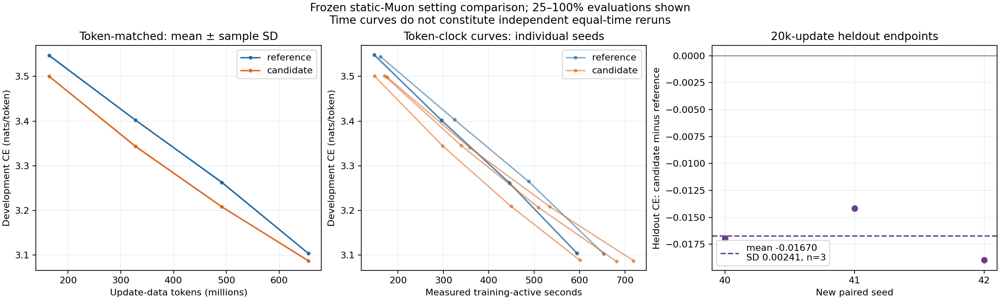

# Three-hour Muon research continuation

Updated2026-10-17T10:56:45.417185+00:00. Requested research/submission window17October2026,07:48:18–10:48:18UTC. Existing confirmations were allowed to finish after cluster recovery; no new experiments were launched after the cutoff. All runs use ONE verified B300, at most SIX outstanding requests, and the50B300-hour PROJECT TOTAL cap.

**Current conclusion: ordinary Muon hyperparameter tuning gives the best development result; none of the tested gap/preset-schedule variants earns a screen win over that stronger static control.** This is not a claim of exhaustive hyperparameter optimality or general algorithmic inferiority.

Same125,829,354-parameter dense depth8/512 model, native ClimbMix/32K tokenizer, BF16 computation/FP32 Muon masters, sequence1024,32768tokens/update, same auxiliary optimizer. Clean native direction retains Nesterov,5Polar Express iterations and Frobenius correction.20k updates=655.36M tokens (~5.21tokens/parameter).

## Completed seed0 development screen

| Setting | Development CE | CLI peak LR | Matrix WD | Terminal factor |
|---|---:|---:|---:|---:|
| Original WD: tuned LR and terminal factor | 3.104185 | 0.01 | 0.18375 | 0.01 |
| Retuned static WD/LR | 3.089540 | 0.02 | 0.0459375 | 0.01 |
| Static contraction-matched control | 3.094227 | 0.01 | 0.116345 | 0.01 |
| Reciprocal-mixing WD | 3.092627 | 0.02 | 0.18375 peak | 0.05 |
| Native cosine WD | 3.094790 | 0.01 | 0.18375 peak | 0.05 |
| Reciprocal LR plus cooldown | 3.096101 | 0.02 | 0.18375 | 0.05 |
| Cheap gap-sign rule | 3.114210 | 0.01 | 0.18375 | 0.05 |

Matrix CLI LR times.25 is actual eta; shape is inside Q. The selected static setting uses ordinary unmasked fixed WD, not cautious decay or gap adaptation. [Exact frozen settings](WINDOW_SELECTION.json), [grid and provenance](WINDOW_STATIC_GRID.md), [refinement batch including deferrals](WINDOW_REFINEMENT_SELECTION.json). Lower matrix WD and terminal-factor refinement materially strengthen the control.

## New paired confirmation

Settings were frozen before NEW seeds40/41/42, with a previously reserved262144-token heldout block4. Initial parameter and heldout-token hashes match within every pair. Three seeds are limited evidence.

| Seed | Reference heldout CE | Retuned static heldout CE | Delta | Reference active sec | Retuned active sec |
|---|---:|---:|---:|---:|---:|
| 40 | 3.185633 | 3.168677 | -0.016956 | 653.26 | 718.94 |
| 41 | 3.186403 | 3.172236 | -0.014166 | 593.85 | 681.48 |
| 42 | 3.190003 | 3.171032 | -0.018971 | 594.65 | 600.63 |

Paired retuned-minus-reference heldout delta: mean **-0.016698CE**, sample SD **0.002413**, n=3. This tests a simpler static recipe; it is not evidence for a new gap algorithm.

[Complete paired report](WINDOW_PAIRED.md).

| Seed | Reference BPB | Retuned BPB |
|---|---:|---:|
| 40 | 0.971947 | 0.966784 |
| 41 | 0.972186 | 0.967873 |
| 42 | 0.973287 | 0.967529 |

**Independent equal-training-time reruns were not launched in this window.** A Run:ai admission TLS/controller outage delayed these existing requests before GPU allocation. Token-clock time curves are descriptive and are not independently matched equal-time endpoints. No practical equal-time superiority is claimed for the new static settings.

## Other evidence and limits

* Plain reciprocal lost all3NEW paired seeds20/21/22 after fair LR retuning: mean heldout delta+0.044014CE, sample SD.003379, versus the original-WD control with terminal fraction.05. This cohort/reference differs from the final40-series cohort. [Full follow-up](FOLLOWUP_RESULTS.md). Earlier wins against a weaker LR control remain explicitly labelled.
* The cheap sign rule loses at its best tested LR; after index1000 all skips occur in tiny value-embedding gates. This tested cheap replacement showed no useful screen gain; long Armijo rates largely saturated their caps. [Cap/sign results](CAP_SIGN_RESULTS.md), [long Armijo saturation audit](GAP_SATURATION_AUDIT.md).
* The fresh-fit controller gate failed7/12 against required8/12, so no new online-controller sweep was launched. [Diagnosis](FRESH_DIAGNOSIS.md).
* Matching final contraction does not match decay history or weight norms. Changing WD changes the domain; exact FP64 spectral analysis found an early mixing-WD setting outside its final ball. [LR/contraction audit](WINDOW_SCHEDULE_AUDIT.md), [saved-weight audit](WINDOW_WEIGHT_AUDIT.md). Finite NS/Nesterov/BF16 do not validate an exact-FW theorem.

## Cost and operational record

Project ledger: **37.070B300 request-hours conservatively charged**, plus0.000reserved. Charge includes queue/startup/cleanup and therefore upper-bounds actual GPU occupancy. The final6requests accumulated1.799summed request-hours BEFORE GPU assignment; that waiting consumed no GPU. Job states:{'completed': 252, 'failed': 2}. All prior/failed jobs remain included.

GPU check001 failed an import-order guard before training; fixed check002 passed native/cap checks and64updates. A controller empty-commit resume issue was fixed without losing training. The first confirmation admission was rejected by a server-side webhook certificate error; normal retry succeeded, but controller/scheduler recovery delayed allocation. No TLS bypass, alternate GPU type, or unrelated-job cancellation was used. The queue now reserves TrainingWorkloads before legacy jobs exist and starts runtime enforcement at pod assignment; five focused queue-state checks pass alongside54optimizer/math CPU checks.

Exact code/configs/results are pushed to `martinjaggi/nanochat:unnormalized-muon`; [minimal changes and reproduction](README.md), [machine-readable ledger](EXPERIMENTS.csv). Raw logs, data and checkpoints stay under `/mloscratch/homes/mljaggi/nanochat-unnormalized-muon-runs/<run_id>/`. The persistent monitor only finishes/records/deletes already accepted requests, with no new submissions.

Recommendation: use the retuned ordinary-Muon setting as the token-matched control, provisionally; all three paired seeds improve. Preserve the negative gap/controller results. A longer-horizon retune and independent full equal-time reruns remain follow-up work, not completed evidence.
