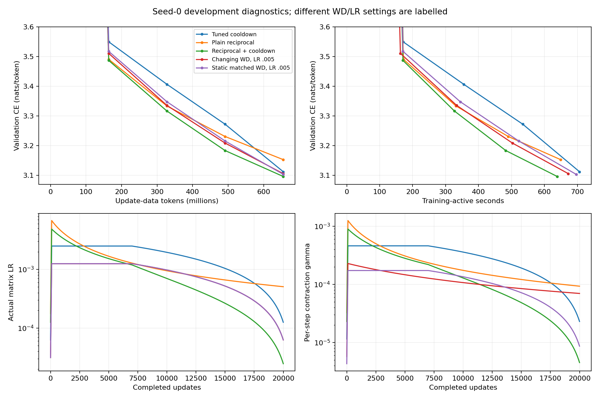

# Independent recorded-schedule audit

Read-only audit of all20,000 recorded update coefficients for each row; no new model evaluations. Recomputed sum log(1-eta*lambda) agrees with each run summary within1e-9. These are development seed0 results, not paired confirmation. Product is the initial-iterate coefficient, not the final weight-norm ratio.

| Method | Val CE | Final actual LR | Final lambda | Log contraction | Active seconds |
|---|---:|---:|---:|---:|---:|
| Tuned cooldown | 3.112087 | 0.00012518269 | 0.1837499 | -6.343333 | 706.571 |
| Plain reciprocal | 3.152773 | 0.00050628982 | 0.1837499 | -5.301866 | 649.252 |
| Reciprocal + cooldown | 3.096101 | 2.4621277e-05 | 0.1837499 | -3.940495 | 638.844 |
| Changing WD, LR .005 | 3.105714 | 6.2591346e-05 | 1.114657 | -2.388109 | 672.405 |
| Static matched WD, LR .005 | 3.103214 | 6.2591346e-05 | 0.1383712 | -2.388109 | 696.460 |

Changing WD and its static counterpart match FINAL log contraction exactly, but have different histories; the static counterpart currently performs better. Reciprocal plus cooldown changes the terminal step AND cumulative contraction relative to either plain reciprocal or the tuned cooldown control, so its preliminary gain cannot be attributed to FW geometry alone. Native auxiliary rules are identical.

Reproduce with `python research/unnormalized_muon/window_diagnostics.py`; output goes to `/tmp/muon-window-audit`, reading persistent logs. Token-matched curves are not independently matched equal-time endpoints.
