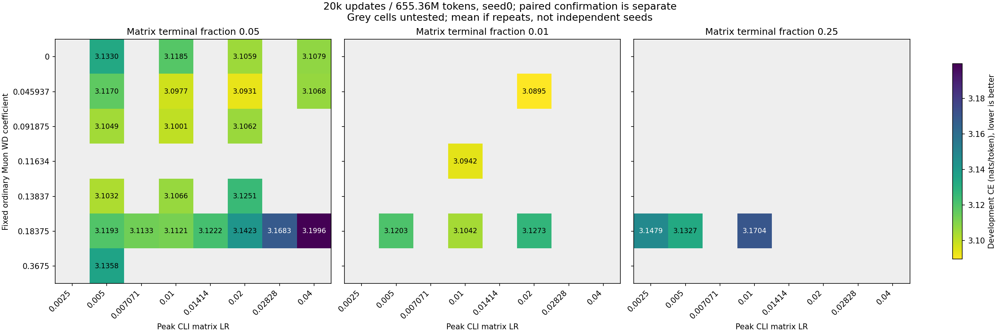

# Static Muon tuning grid

Completed seed0 development endpoints only,20k updates/655.36M tokens; paired confirmation is separate. Same ClimbMix/32K tokenizer,125,829,354-parameter depth8 model, clean Muon, native auxiliary recipe. CLI matrix LR times.25 is actual peak eta; Q includes shape c. Grey cells were not tested. Separate panels keep terminal fractions distinct. All underlying runs and source commits are in [scalar provenance](WINDOW_STATIC_GRID.json).

The best tested static setting reaches3.089540CE: CLI matrixLR.02, fixed lambda.04593746995939655, matrix terminal factor.01. This is seed0 selection, not independent confirmation. Best LR was bracketed before terminal refinement; this is not an exhaustive continuous joint optimum. [Frozen comparison](WINDOW_SELECTION.json) records the original-WD reference and new-seed settings.

Reproduce with `python research/unnormalized_muon/window_grid_plot.py`; outputs `/tmp/muon-window-audit`. The separate `confirmation_plot.py` reads completed seeds40/41/42 and explicitly labels token-clock time curves as distinct from equal-time reruns.
